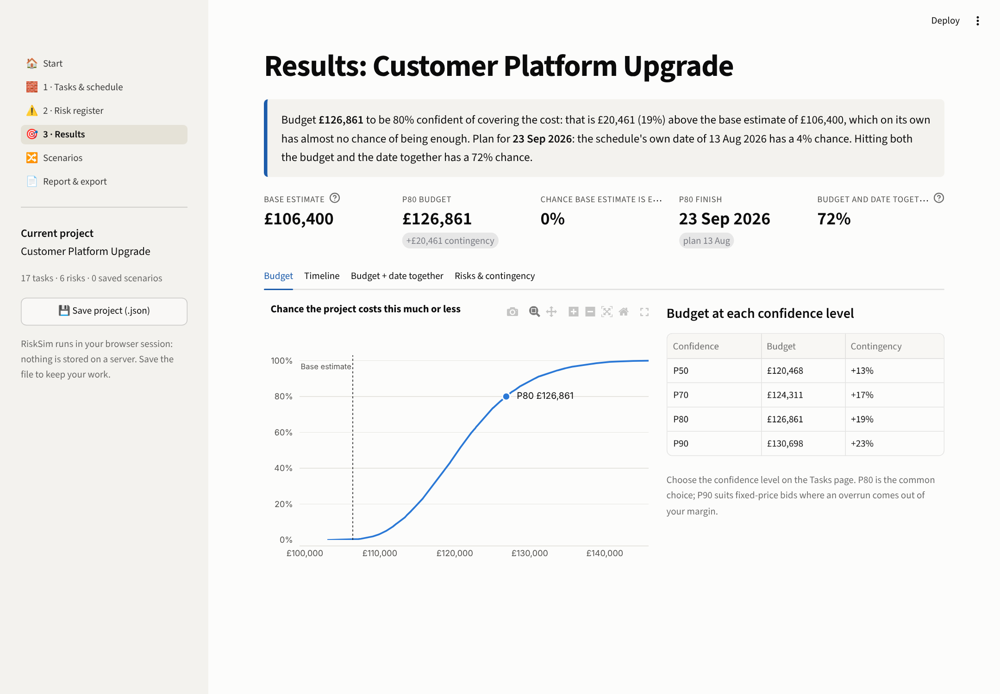
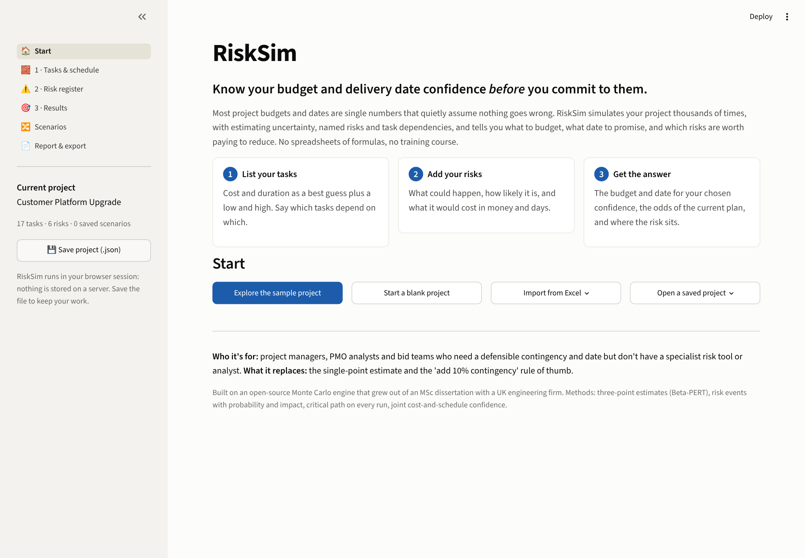
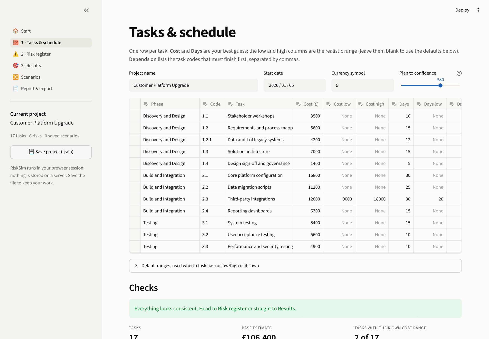
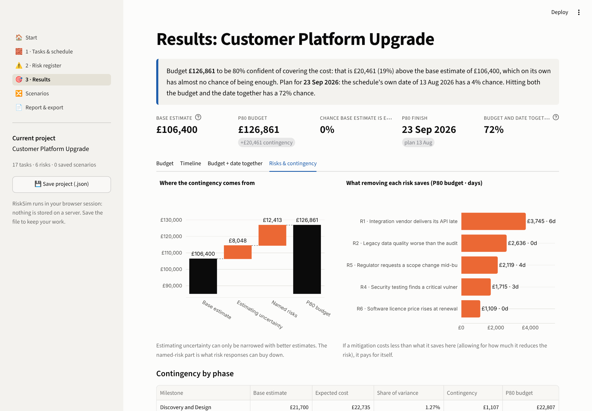
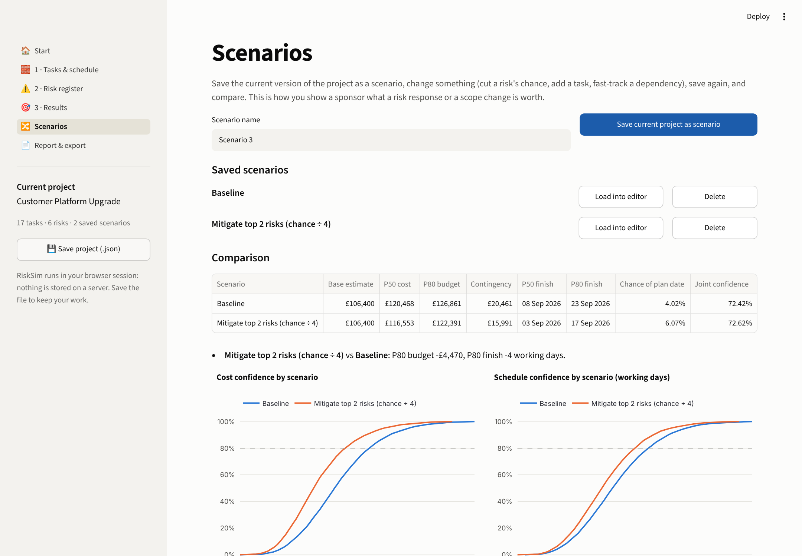

# RiskSim

**Know your budget and delivery date confidence *before* you commit to them.**

RiskSim is a browser app for project managers, PMOs and bid teams. List your tasks, add your risks, and in minutes it tells you:
- what to budget;
- what date to promise;
- the odds of the plan you have today;
- which risks are worth paying to reduce.

No spreadsheets of formulas, no install, no risk analyst.



> **Product case study.** This repo contains the working MVP **and** the product thinking behind it: problem, personas, requirements, competition, roadmap, pricing hypotheses, metrics and decisions. See [`product/`](product/).

---

## The problem it solves

Most budgets and dates are single numbers: add up the estimates, put 10% on top, commit. For the sample project, a £106,400 IT platform upgrade planned to finish on 13 Aug 2026, RiskSim shows that:

| What the plan says | What 10,000 simulations say |
|---|---|
| Budget £106,400 | Almost no chance that's enough. **£126,861** gives 80% confidence |
| Finish 13 Aug 2026 | **4% chance.** The 80% date is **23 Sep 2026** |
| P80 budget and P80 date look like "80% confident" | Meeting **both** has a **72%** chance |
| Risk register ranked by probability × impact | The data-quality risk adds £2,636 to the P80 budget and **zero days**, because its task has spare time in the schedule |

## How it works for the user

| 1 · Tasks & schedule | 2 · Risk register | 3 · Results |
|---|---|---|
| A best guess plus low/high for cost and days, and what each task depends on. Import from Excel or type in the browser | What could happen, how likely, what it costs in money and days, which task it hits | A plain-English answer, then budget, timeline, joint confidence, risk ranking and contingency |

Then:
- **Scenarios** save versions of the project and compare them. "Mitigating the two biggest risks saves £4,470 at P80 and 4 working days."
- **Report & export** produces a one-page Word board report, the full analysis in Excel, and a project file to reopen later.

| | |
|---|---|
|  |  |
|  |  |

## Product decisions worth noting

- **No accounts, no server storage.** The project lives in a file the user downloads, which removes the data-security approval that blocks most enterprise tools ([decision log](product/08_decision_log.md)).
- **Risks are events, not percentages.** Loading every task by its risk percentage (the method in my original dissertation) treats every risk as certain and over-budgets the sample by about £40k.
- **Validation in plain English that names the task,** e.g. "1.3 Solution architecture: cost low ≤ cost ≤ cost high is not true", so users fix inputs instead of abandoning.
- **Risks ranked by what they do to the P80 budget and date,** not by probability × impact.

## Product documents

| Document | What's in it |
|---|---|
| [Problem & vision](product/01_problem_and_vision.md) | The problem, who feels it, vision, scope boundaries |
| [Personas](product/02_personas.md) | PM, bid manager and PMO lead, each with a job to be done, plus an anti-persona |
| [Requirements (PRD)](product/03_prd.md) | Goals, non-goals, user stories with acceptance criteria and MVP status, non-functional requirements |
| [Competitive landscape](product/04_competitive_landscape.md) | Spreadsheets, @RISK, Primavera Risk Analysis, Safran; positioning |
| [Roadmap](product/05_roadmap.md) | RICE-scored Now / Next / Later, and what we won't build |
| [Pricing & go-to-market](product/06_pricing_and_go_to_market.md) | Tier hypotheses, riskiest assumptions and how to test them |
| [Metrics & user testing](product/07_metrics_and_testing.md) | North-star metric, funnel, guardrails, a 5-user usability test script |
| [Decision log](product/08_decision_log.md) | Eight key decisions, options considered, and when to revisit |

## Run it

```bash
git clone https://github.com/Divyaprakash-SM/risksim.git
cd risksim
pip install -r requirements.txt
streamlit run app.py
pytest          # 37 tests: engine maths, schedule logic, validation, save/load, reports
```

**Deploy free:** [share.streamlit.io](https://share.streamlit.io) → **Create app** → this repo, branch `main`, file `app.py` → **Deploy**.

## How it's built

```
risksim/
├── app.py               navigation and sidebar (current project, save)
├── views/               start · tasks · risks · results · scenarios · report
├── risksim/
│   ├── project.py       project model, plain-English validation, JSON save/load, Excel import
│   ├── engine.py        runs the simulation, writes the headline answer, compares scenarios
│   ├── report.py        one-page Word board report and Excel export
│   └── ui.py            theme, session state, editable tables that persist across pages
├── montecarlo/          simulation engine (from Monte-Carlo-Simulation v3)
├── product/             product documents
├── data/                sample project (.json) and Excel template
└── tests/
```

The engine is the [Monte Carlo cost and schedule risk model](https://github.com/Divyaprakash-SM/Monte-Carlo-Simulation) that began as my MSc dissertation with Synoptix, a UK engineering firm. RiskSim is the product layer on top: who it's for, what they need to see, and how they get there in minutes.

**Stack:** Python · NumPy · SciPy · pandas · Plotly · Streamlit · python-docx · pytest

## Status

MVP (v0.1): all 12 MVP user stories are built and tested. Next: a 5-user usability test, then a mitigation-cost calculator and MS Project import ([roadmap](product/05_roadmap.md)).

---

**Divyaprakash S M** · PMP · PRINCE2 Agile Practitioner · MSc Business Analytics (University of Southampton)
